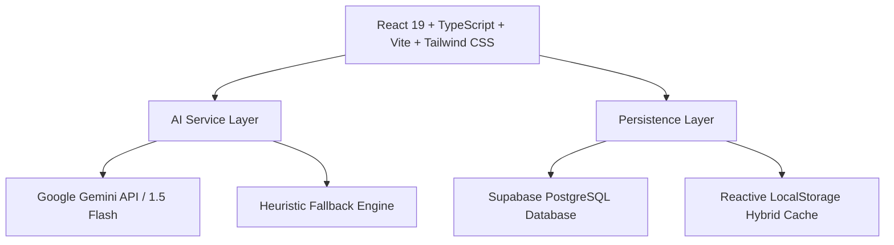

# 🧭 Career Pilot — AI Career Pivot Coach

> **Bridging the gap between where you are and where you want to be.**  
> An intelligent, forensic career pivot platform powered by **Google Gemini AI**, **React 19**, **TypeScript**, **Tailwind CSS**, and **Supabase**.

---

## 🌟 Hackathon Demo Story (For Judges)

### The Candidate Scenario:
- **Candidate:** Alex Morgan (Full Stack Engineer with 3.5 years experience in Node.js, Express, and PostgreSQL).
- **Pivot Target:** **Senior Java Backend Engineer** at **Apex Fintech Platforms** ($155,000 - $185,000).

### What Judges Experience:
1. **AI Career Diagnosis:**
   - Candidate uploads their resume against the Senior Java Backend JD.
   - Gemini performs a forensic audit: 68% Role Fit, 65% Match, 35% Critical Gap.
   - Detects transferable strengths (REST APIs, PostgreSQL, Docker) but flags missing evidence: **Apache Kafka exactly-once semantics**, **Java 21 Virtual Threads**, and **Resilience4j**.
2. **Personalized 7-Day Sprint Plan:**
   - Calibrates an actionable day-by-day roadmap (Days 1–7) with concrete deliverables, curated resources, and daily mini-quizzes.
3. **AI Mock Technical Interview:**
   - Candidate is asked: *"How do you guarantee exactly-once processing and prevent duplicate message consumption in Apache Kafka when processing financial transactions in a Spring Boot application?"*
   - Candidate answers superficially: *"I just put `@KafkaListener` and add try-catch... Kafka drops it."*
   - AI evaluates with strict multi-criteria rubrics (Score: **34/100, Critical Gap**), identifying weak topics (`Kafka Idempotency`, `Transactional Outbox Pattern`).
4. **Adaptive Priority Engine:**
   - The AI coach **dynamically recalibrates the 7-day sprint plan**: lowers Kafka mastery, injects an emergency remedial deduplication task into Day 4, and logs the adaptation in real time.
5. **Job Application CRM Tracker:**
   - Candidate manages active applications (Apex Fintech, Revolut, Stripe, Monzo) with interview dates, next actions, fit scores, and follow-up reminders.

---

## 🚀 Key Features

### 1. 🔍 AI Career Diagnosis & Forensic Gap Audit
- **Resume & Job Description Analysis:** Accepts candidate resume and targeted employer JD.
- **Evidence Parity Audit:** Identifies exact resume lines matching JD requirements, critical skill gaps, and weak/vague evidence.
- **Role Fit Score & Metric Dial:** Clear quantifiable matching percentages.
- **Interview Focus Areas:** Highlights critical probing questions hiring managers will ask.

### 2. 📅 Personalized 7-Day Sprint Plan & Adaptive Learning Engine
- **Day-by-Day Roadmap:** Structured 7-day curriculum tailored to the candidate's exact gap profile.
- **Actionable Tasks & Checklists:** Includes concrete deliverables and verified learning resources.
- **Interactive Daily Mini-Quizzes:** Conceptual quizzes with immediate explanations and confetti celebrations.
- **Dynamic Mastery Tracking:** Real-time skill mastery progress bars that adapt to task completions.
- **Adaptive Priority Recalibration:** Automatically modifies upcoming days when mock interviews reveal weak spots.

### 3. 🎙️ AI Technical Mock Interview Coach
- **Role-Specific Questions:** High-stakes technical and architectural questions.
- **Voice Dictation:** Built-in speech-to-text recognition via Web Speech API.
- **Multi-Criteria Scoring Rubrics:**
  - Technical Depth (0–100)
  - System Architecture (0–100)
  - Clarity & Structure (0–100)
  - Evidence & Guarantees (0–100)
- **Weak Topic Identification:** Tags exact knowledge deficits.
- **Gold-Standard Senior Answer:** Displays ideal production-grade answers.
- **1-Click Sprint Sync:** Propagates weaknesses into the 7-day learning sprint.

### 4. 💼 Job Application Pipeline CRM
- **Dual View Modes:** Interactive Kanban Board and searchable Table List view.
- **Pipeline Stages:** Wishlist ➔ Applied ➔ Interviewing ➔ Offer ➔ Archive.
- **Follow-Up Reminders:** Highlights upcoming follow-up deadlines and next interview steps.
- **Add / Edit / Delete Target Jobs:** Easily track salaries, links, notes, and fit scores.

---

## 🛠️ Architecture & Tech Stack



- **Frontend:** React 19, TypeScript, Vite, Tailwind CSS v4, Lucide React icons, Canvas Confetti.
- **Backend / Database:** Supabase PostgreSQL with complete Row-Level Security (RLS) policies.
- **AI Engine:** Google Gemini API (`gemini-1.5-flash` / `gemini-2.0-flash`) with structured JSON schema mode and zero-friction fallback simulation.
- **Hosting & Deployment:** GitHub + Vercel SPA routing (`vercel.json`).

---

## 📦 Supabase Setup Guide

1. Log into your [Supabase Dashboard](https://supabase.com) and create a new project.
2. Open the **SQL Editor** in the Supabase dashboard.
3. Paste and execute the contents of [`supabase/schema.sql`](./supabase/schema.sql).
4. Copy your **Project URL** and **Anon Public API Key** from `Project Settings > API`.
5. Add them to your `.env.local` or directly configure them via the **Settings (⚙️)** modal in Career Pilot.

```env
VITE_GEMINI_API_KEY=your_gemini_api_key_here
VITE_SUPABASE_URL=https://your-project.supabase.co
VITE_SUPABASE_ANON_KEY=your_supabase_anon_key_here
```

> **Note for Judges:** Career Pilot features a **Hybrid Engine**. If Supabase credentials or Gemini API keys are omitted, the application runs on high-fidelity simulation and reactive local storage with zero blockers!

---

## 🚀 Getting Started Locally

```bash
# Clone the repository
git clone https://github.com/your-username/career-pilot.git

# Enter project directory
cd career-pilot

# Install dependencies
npm install

# Run development server
npm run dev
```

Open [http://localhost:5173](http://localhost:5173) in your browser.

---

## 🌐 Deploy to Vercel

1. Push this repository to GitHub.
2. Import the repository in [Vercel](https://vercel.com).
3. The build command will automatically be `npm run build` and output directory `dist`.
4. (Optional) Set `VITE_GEMINI_API_KEY`, `VITE_SUPABASE_URL`, and `VITE_SUPABASE_ANON_KEY` in Vercel Environment Variables.
5. Deploy!

---

## 🏆 Hackathon Quick-Start Checklist

- [x] Click **⚡ Judge Demo Story** in the top navigation bar.
- [x] Review the **Forensic Gap Audit** under *Skill Diagnosis*.
- [x] Inspect the **Day 1 to Day 7 Sprint Tasks** and take the *Day 1 Mini-Quiz*.
- [x] Go to *Mock Interview*, click **Judge Demo Weak Answer**, and click **Evaluate**.
- [x] Click **Sync to 7-Day Sprint** to witness real-time adaptive recalibration of Day 4!
- [x] Check the *Job Tracker* to manage application follow-ups.
